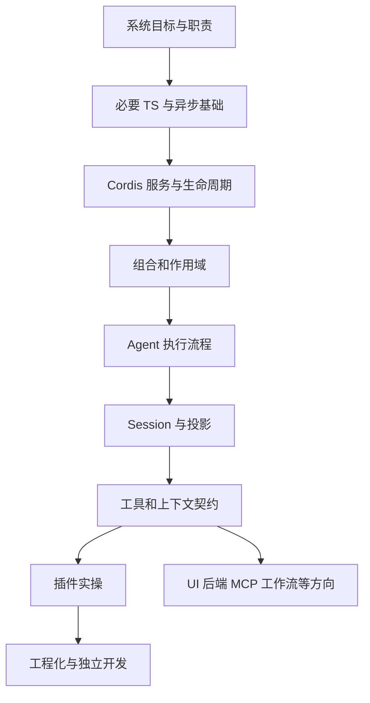

# 0. 学习目标、依赖顺序与验收

本页是一条学习路线。默认不设置总学习时长；以能解释和能完成的结果推进，避免把阅读页数当作理解程度。

## 两个目标

主目标 B：能把一个独立需求实现为原生插件，声明依赖，正确注册能力，处理输入/输出、取消与清理，在真实框架中验证，并理解怎样加载和分发。次要目标 A：能画出架构、解释一次执行、判断扩展点及受影响的系统。

要达到 B，先达到 A 的核心部分。没有必要先熟悉所有包；需要知道怎样从需求找到拥有该能力的服务、注册机制和验证方式。

## 学习依赖

每个箭头表示后一个主题依赖前一个概念。例如，先理解 effect 的所有权，再解释工具为何在卸载时撤销；先理解 Session，再解释为何不能随意改已组装请求。

## 四个阶段

| 阶段 | 阅读与行动 | 验收 |
|---|---|---|
| 认识系统 | 第 1 章，画一次输入的路径 | 分清模型、loop、工具服务、Session 与 Cordis |
| 理解机制 | 第 2—6 章，预测执行时序 | 解释 inject、effect、scope，区分 turn 与 step |
| 完成引导实操 | 第 7、8、10 章，运行并改动示例 | 输入错误、依赖消失、取消与卸载均可解释 |
| 独立完成插件 | 第 9、11 章，选择自有需求 | 无模板依赖地选扩展点、设计返回值、完成验证 |

阶段一和二的验收对应次要目标 A。阶段三提供主目标 B 所需的实际经验，阶段四才是“独立完成”。收到本知识库并不等于已掌握这些能力。

## 每章的使用方式

先用自己的话复述章首问题。阅读后预测一个变更会造成什么结果，再查源码验证。最后回答章末问题；卡住时先找不懂的前置概念，回到依赖顺序，而不是继续阅读更多包。

源码阅读保持三层：服务声明告诉你使用者可以依赖什么；具体实现告诉你实际怎样实现；测试告诉你异常路径与行为边界。只读其中一层，会分别缺少实现证据、全局关系或失败条件。

## 独立项目建议

第一个独立项目可以是“从你自己的术语文件检索解释”，把贯穿示例的内存提供方换成文件提供方。第二个项目再加入持久收藏、业务 UI 或外部服务，从而学习新扩展点。每次只新增一个主要机制，保持可以说明其作用和验证范围。

## 自检

现在能否说明：为什么计划先学 Cordis，而不是直接跟读 agent-loop 的每个函数？参考答案见[练习](reference/exercises.md)。下一章：[系统全景](01-system-overview.md)。
