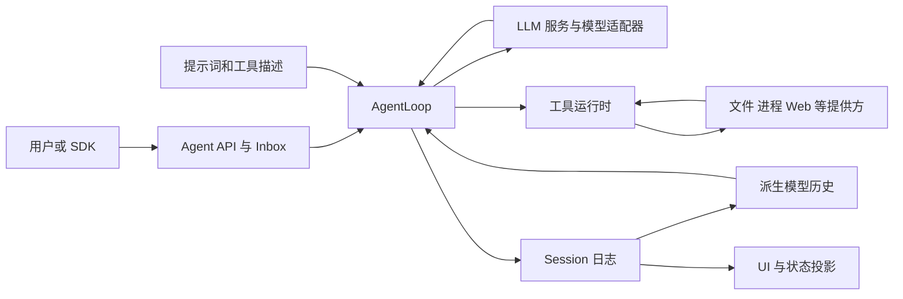

# 1. 系统全景：Harness 在解决什么问题？

本章建立整体认识。学完后，你应能解释项目职责、主要数据路径，以及“一切皆插件”对开发者的实际意义。

## 从模型能力到系统能力

一次 LLM 调用接受消息和工具描述，输出文本或工具调用。它不会替你管理进程、保存会话、恢复执行、决定权限、隔离不同 agent 的工具，也不会自动把工具结果加入后续请求。Harness 把这些责任组织起来，使模型能够在一个持续运行、可观测和可扩展的系统中工作。

因此，“接入新模型”和“增加文件工具”是不同工作。前者改变模型协议的适配，后者改变可执行能力。DeepSeek Harness 把两者以及管理它们的循环都拆成 Cordis 插件。

## 用五个视角理解项目

| 视角 | 回答的问题 | 主要组成 |
|---|---|---|
| 组合 | 本次运行有哪些能力？ | CLI、profile、bundle、patch、preset |
| 控制 | 下一步执行什么，何时结束？ | Agent API、Inbox、AgentLoop、事件 |
| 模型输入输出 | 模型看到什么、返回什么？ | prompt assembly、LLM adapter、stream、工具 schema |
| 状态 | 哪些事实要保存与重放？ | Session、消息投影、状态投影、持久化提供方 |
| 产品交互 | 人如何使用与观察系统？ | Web/desktop、Host/Client、SDK、审批与命令 |

这些是学习视角，不是额外存在于代码中的五个模块。一个包可以参与多个视角；后续源码导航会明确它实际拥有的责任。

## 最小主干图

Cordis 在图的外层组装这些节点，管理依赖和卸载。箭头表达职责关系；精确时序在第 5 章。

## “一切皆插件”的含义

`dsh-agent` 声明 Agent 服务与事件；`dsh-agent-loop` 是默认实现。UI 和扩展通常依赖前者，而无需直接依赖这个具体循环。`dsh-llm` 提供适配器注册与流式协议；DeepSeek 适配器实现模型端通信。`dsh-tools` 提供工具注册与执行；具体工具注册进去。

模型提供方、工具和循环本身都能在配置中选择或替换。这不意味着任意替换都没有成本：替代实现必须满足消费方依赖的语义，装配必须完整，持久数据还要满足格式要求。

## 一个实际需求如何落在架构里

假设你希望 agent 检索个人笔记。模型需要一个描述清楚的检索工具；检索实现需要一个文件或外部服务提供方；结果需要形成规范值，再渲染为模型可读内容。如果你还希望展示历史收藏，就需要 Session 事件与 UI 投影。需求从一个工具，逐渐涉及状态和产品呈现；这正是先认识整体架构的价值。

## 项目记录的设计原因

能力定义、实现、消费接口的变化速度不同。把它们绑定在一个包里，会让“换执行后端”牵连模型工具接口。项目用 Service Definition、Service Provider、Consumer 三种角色组织可替换能力，也称一个完整的 capability seam。并非每项小能力都必须立刻拆成三个包；独立演进时再分包。理由与代价见[设计记录](reference/design-decisions.md)。

学习解释：这与 C++ 通过抽象接口替换实现有联系，但 Cordis 还负责运行期间依赖消失后的卸载和重启；它超出单纯的函数调用抽象。

## 源码定位与自检

先读[架构](../../architecture.zh.md)，再打开[包地图](../../../packages/README.zh.md)。源码先定位 `packages/core/agent/src/index.ts` 与 `packages/core/agent-loop/src/agent.ts`，只对照“声明”和“实现”的职责，暂不通读循环。

自检：LLM 返回一个工具调用时，哪个组件实际执行它？为什么 SDK 能驱动 agent，却不等于可以直接用 Python 编写同进程 Cordis 插件？下一章：[语言与运行时](02-language-and-runtime.md)。
