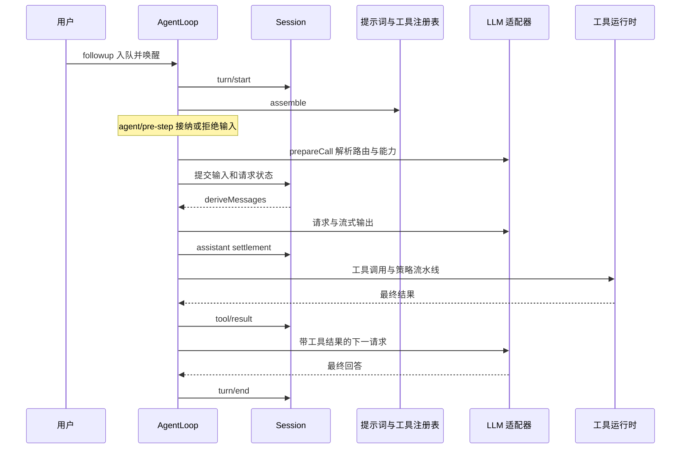

# 5. 一次完整运行：输入怎样变成行动？

本章沿一次已执行的例子解释控制流程，而不是逐文件阅读。示例使用真实 AgentLoop、Inbox、Session 和工具，只有模型端由脚本适配器替代。

## Agent、turn、step、attempt

Agent 是持续存在的运行对象，拥有 Session、输入队列和状态。turn 是一段已打开的工作区间，包含零个或多个 step；输入被拒绝或首次输入被改为空时，可能有 turn 而没有模型调用。step 包含模型调用和该响应引发的工具处理。失败或重试可能产生多个模型 attempt，不能把每次网络尝试当成新的 step。

示例询问“什么是 seam”：第一次请求产生 `study_lookup` 工具调用，工具返回解释；第二次请求读取工具结果，给出答案。因此是一个 turn、两个 step。

## 实际观测到的主干日志

下面摘自[完整追踪](examples/study-terms/trace.txt)，省略两条 Inbox 更新和部分细节：

```text
turn/start
  step/start
    system/message
    user/message
    request/header
    request/context
    assistant/message
    tool/call
    tool/result
  step/end
  step/start
    assistant/message
  step/end
turn/end
```

这是当前例子的执行结果，不是所有请求都必须逐字重复的模板。后续 step 没有变更时，不必重复记录同样的 header 与 context。第二次请求的输入包含首轮模型消息和工具结果；脚本对此作了断言。

## 执行过程与可扩展时点



源码中的 `preStep()` 从 Inbox 领取输入并组装贡献，`agent/pre-step` 可以返回 enter/reject。`prepareRequest()` 经 `agent/request` 解析模型配置，再准备调用。`buildRequest()` 对齐日志中的请求信息，调用 `deriveMessages()` 并冻结请求。模型流结束后提交 settlement；工具调用经 ToolRuntime 执行，结果提交到 Session，然后循环决定是否还欠下一次模型请求。

这里的顺序有意义：路由能力解析在系统与用户消息正式提交之前，取消可以阻止未接纳的输入被写成已用消息。重试复用已经完成的组装和 pre-step，不应假定每个 attempt 都会重新运行该阶段。

## 三种输入行为

| 方法 | 意图 | 唤醒与接纳 |
|---|---|---|
| `followup()` | 后续工作 | 投向 next-turn 并唤醒驱动 |
| `steer()` | 正在执行时引导下一步 | 投向 next-step 并唤醒 |
| `inject()` | 补充上下文 | 投向 next-step，但本身不唤醒 idle agent |

队列分配与接纳不是同一时点。领取输入之后发生的注入不能回头修改已构造的请求；必须影响本次接纳的消息时使用 `agent/pre-step` 返回通道。`agent.inject` 与 Cordis `inject` 的名字相同，职责完全不同。

## 为什么不能在任意地方改 messages？

项目要求每次模型请求可由日志重建。插件通过受支持的接纳、上下文和配置通道贡献，循环再生成请求；请求被冻结，取消 signal 仍可变化。随意编辑临时消息数组会破坏“恢复后所见输入等于实际所见输入”的保证。设计依据见[请求重建记录](reference/design-decisions.md)。

## 结束、错误与清理

`agent/turn-stopping` 是串行的结束协作点，可能通过下一步输入继续工作；它不是一个带 `next()` 的 waterfall。取消和异常形成结构化 turn 结束原因。已记录工具调用但缺少结果时，循环尝试记录恢复结果，避免留下不完整配对。持有者退出需要等运行停稳，不能只从注册表删除 Agent。

## 源码与自检

定位[agent.ts](../../../packages/core/agent-loop/src/agent.ts)的 `send()`、`preStep()`、`turn()`、`step()`、`prepareRequest()`、`buildRequest()`；不要先展开所有依赖。[Agent lifecycle](../../agent-lifecycle.zh.md)提供更完整时序。

自检：本例为何有两次模型请求？给 idle agent 注入上下文会不会立刻产生第三次请求？下一章：[Session 与投影](06-session-and-projection.md)。
