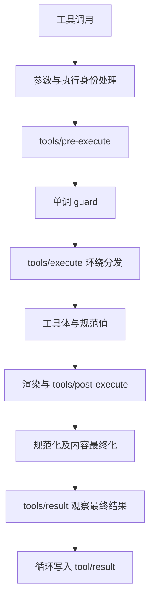

# 7. 工具：模型、程序和 UI 各需要什么？

本章把工具当作系统接口来理解。编写一个工具时，既要定义模型能发什么参数，也要定义程序能拿到什么结果，以及结果怎样被展示。

## 四份信息分别服务谁

| 信息 | 用途 | 示例中的位置 |
|---|---|---|
| name、description、parameters | 模型理解何时调用、怎样调用 | `study_lookup` 的 schema |
| canonical value | 程序读取明确的字段与句柄 | `{ term, definition }` |
| output.render 的 content | 向模型表达结果 | 一条 text block |
| presentation/UI metadata | 人类界面呈现与回放 | 本例使用通用工具展示 |

返回值不应该只有“查到啦，解释是……”这样的 prose，让程序再解析它。项目的 `defineTool` 通过 `output.schema` 推导规范值类型，`execute` 返回该值，`output.render` 把它转成模型内容。输出对象显式声明 `additionalProperties`。

## 校验分成两层

`defineTool` 校验类型、必需字段和 DSL 能表达的约束；业务体处理空白字符串、跨字段条件等业务约束。示例里传入数字会在参数校验失败；传入空白字符串会在业务校验失败；词条不存在则返回 `definition: null`，这是成功的业务结果，不是基础设施错误。

输入通过执行入口转换为冻结的、无损 JSON 数据，避免策略与工具体看到互相冲突的可变参数。执行身份如 callId、name、agent、token 受保护。环绕分发中间件可以替换并恢复 signal 来施加截止时间，但不能任意修改身份。

## 执行流水线

这是成功路径的学习图；拒绝、批准、异常和工具自身的内容处理会形成分支。完整分支见[官方工具流水线](../../tool-execution-pipeline.zh.md)。普通 policy、不可撤销的拒绝、环绕执行、结果变换和最终观察使用不同 API：

| 目的 | 机制 | 为什么选它 |
|---|---|---|
| allow/deny/ask | `tools/pre-execute` | 可组合前置策略 |
| 最终拒绝，不允许后续监听器撤销 | `ctx.tools.guard()` | 单调约束 |
| 超时、重试、包裹执行 | `tools/execute` | 能进入并等待下游 |
| 替换结果或追加上下文 | `tools/post-execute` | 明确执行后变换 |
| 观察最终结果 | `tools/result` | 已规范化、不可变的事实 |

如果只是观察，却放进改写阶段并忘记 `next()`，就可能改变产品行为。工具体抛错、schema 不符或渲染失败会被规范化成错误结果。插件应该验证失败路径，而不只验证正常返回。

## Native 与 PTC

Native 模式下，模型直接看到工具 schema，收到渲染内容。PTC 是 Programmatic Tool Calling：模型生成程序，程序可以 `await tools.study_lookup(...)`，拿到规范 JSON 值，然后继续调用其他工具。子调用重新进入工具流水线，不能因为是代码调用就绕开策略。

`run_code` 是保留的传输名称，不能注册或遮蔽。具体 PTC runtime 与策略由配置决定；本实操没有挂载该运行时，因此不把 PTC 描述成已经实测的路径。

规范值是执行期间的程序接口，不自动写进持久 `tool/result`。模型 content 与需要时投影出的 presentationMeta 才按日志约定保存。要恢复持久业务状态，使用明确的 Session 事件，而不是假定所有返回对象都已存档。

## 前台、后台与取消

前台工作绑定 `exec.signal`。后台工作需要由 `ctx.jobs` 接管任务身份、输出和所有权；任务公布后使用任务自己的取消生命周期。否则“调用结束/取消”可能错误地杀死应该持续的后台工作。具体规则按[jobs](../../../packages/jobs/jobs/README.zh.md)查阅。

## 自检与源码

如果结果既有给程序用的 jobId，也有给模型的解释，应怎样组织？把 content 替换成保密文字，是否会同时抹掉程序可读 value？来源：[工具参考](../../cookbook/adding-a-tool.zh.md)、[ToolRuntime](../../../packages/core/tools/src/index.ts)、[schema](../../../packages/core/tools/src/schema.ts)。下一章：[上下文与模型](08-context-and-model.md)。
