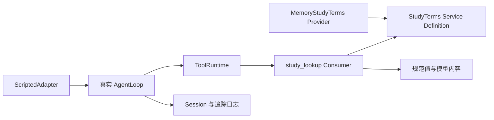

# 10. 贯穿实操：一个可以换后端的词条检索插件

本章是一条可运行的教程。完成后，你能解释真实工具的注册、规范返回、事件中间件、取消以及服务替换，并在真实 AgentLoop 中观察工具结果进入下一请求。

## 前置条件与范围

先读第 2、3、5、7 章。当前工作区已准备项目依赖；示例使用检出的源码，不依赖 API key，不调用外部模型。它是学习用的进程内测试组合，不是替代 `dsh` 的生产应用入口。

安装依赖时使用了锁文件和 `--ignore-scripts`；这满足本例源代码测试的依赖需要，但不代表仓库的原生模块或完整发布产物已准备完毕。示例从仓库工作目录运行，以使用其源码模块解析规则；移出当前目录时必须同步调整路径。

## 1. 看清设计，再看代码



三个角色为了教学分成文件，尚未拆成三个 npm 包。一个只有单一实现的小插件不必先承担多包成本；本例为了展示后端替换而显式区分职责。

| 文件 | 学习重点 |
|---|---|
| [service.ts](examples/study-terms/service.ts) | 运行时 Service 与编译时 Context 扩展 |
| [provider.ts](examples/study-terms/provider.ts) | 配置校验、内存实现、取消信号 |
| [tool.ts](examples/study-terms/tool.ts) | inject、输入 schema、规范值与模型 rendering |
| [verify.ts](examples/study-terms/verify.ts) | 真实注册与执行，失败和替换验证 |
| [trace.ts](examples/study-terms/trace.ts) | 脚本模型配合真实 AgentLoop 的两个 step |
| [scopes.ts](examples/study-terms/scopes.ts) | 注入依赖后创建 scope，验证层级和卸载 |

## 2. 先预测正常与异常行为

查询 `seam` 返回 `{ term: 'seam', definition: 'Definition + Provider + Consumer' }`。查询未知词返回 definition 为 null，表示正常完成但没有匹配项。数字参数违反类型约束，空白参数违反业务约束，已取消调用不会进入工具 dispatch。

阅读 tool 文件时，找出这四种结果由哪一层决定。特别注意 `execute` 返回规范值，`render` 返回 content block，二者不是同一个值。

## 3. 运行真实工具验证

以下是已在当前工作区执行成功的命令：

```sh
# 在仓库根目录运行
node --import tsx/esm docs/learning/deepseek-harness/examples/study-terms/verify.ts
```

输出 8 条 PASS，保存在[verification.txt](examples/study-terms/verification.txt)。验证还包括：最终结果观察能看到错误；卸载环绕中间件后它不再运行；移除提供方会撤销依赖工具；重新提供服务后原消费插件再次激活并使用新解释。

先执行，再用自己的话说明：为什么测试没有重新手动注册消费方，却能够读到新后端？答案是 Cordis 持续维护依赖关系，而不是工具缓存了旧提供方对象。

## 4. 在真实循环中观察两次请求

```sh
# 在仓库根目录运行
node --import tsx/esm docs/learning/deepseek-harness/examples/study-terms/trace.ts
```

输出 16 条带 seq 的 Session 事件及一条 PASS，事件保存为[trace.txt](examples/study-terms/trace.txt)。脚本模型第一次要求调用工具，第二次检查请求包含 `role: 'tool'` 消息后给出答案。真实循环负责输入接纳、调用工具、追加结果和结束轮次；模型选择行为则完全由脚本指定。

将输出与第 5 章对照。工具结果是独立的 tool-role 消息，而不是任意名为 tool-result 的文本 block。按项目的实际消息类型理解协议，不要套用其他 SDK 的消息结构。

要验证第 4 章的注册视图，可以运行：

```sh
# 在仓库根目录运行
node --import tsx/esm docs/learning/deepseek-harness/examples/study-terms/scopes.ts
```

该实验以已注入 tools 的插件创建三个 scope，验证子层遮蔽父层、兄弟仍继承全局、卸载后恢复祖先视图。输出见[scopes-verification.txt](examples/study-terms/scopes-verification.txt)。

## 5. 做一次最小改动

先在 verify 的词条配置加入 `effect`，再加一条查询断言，确认返回的规范值与渲染内容对应。然后把查询空白的行为改为你选择的明确错误说明，并检查它仍作为 isError 返回。

接着实现一个新的提供方，如大小写无关的检索，保持 `StudyTerms.lookup()` 和 tool 文件不变。成功条件是：同一 Consumer 与输入/输出接口继续工作。这个练习验证你是否理解能力角色，而非只是修改字符串。

## 6. 从内存走向文件与持久业务

如果换成文件提供方，先声明文件格式、路径来源、获取上限和取消策略。放进真实产品时应选择项目的文件能力，而不是默认直接使用本地 Node API，否则可能绕过远程执行世界与文件策略。

“检索文件”与“持久收藏”是不同需求。后者应设计自己的业务事实与投影，再决定是否要模型内容和 UI。先阅读 todo 示例，画出收藏事件 → 投影 → 展示的路径，然后再写代码。

## 验证边界与后续产品集成

本例验证了 native 工具、依赖替换和实际循环的内存日志；未验证真实模型选工具、磁盘恢复、PTC、MCP、Web/desktop UI 或 npm 安装。真实产品通过 profile + patch 加载，并需要相应的 built 产物；后续按官方[第一个插件](../../user/develop/basic/index.zh.md)和[打包安装](../../user/develop/basic/publish.zh.md)执行集成。不能把测试组合成功当成正式 bundle 已可安装。

自检：你能在不看 verify 的情况下重新写出行为验收条件吗？下一章：[工程化](11-engineering.md)。
